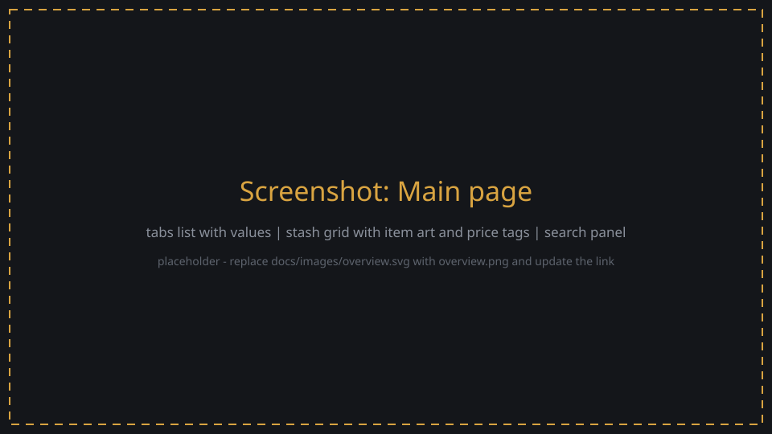
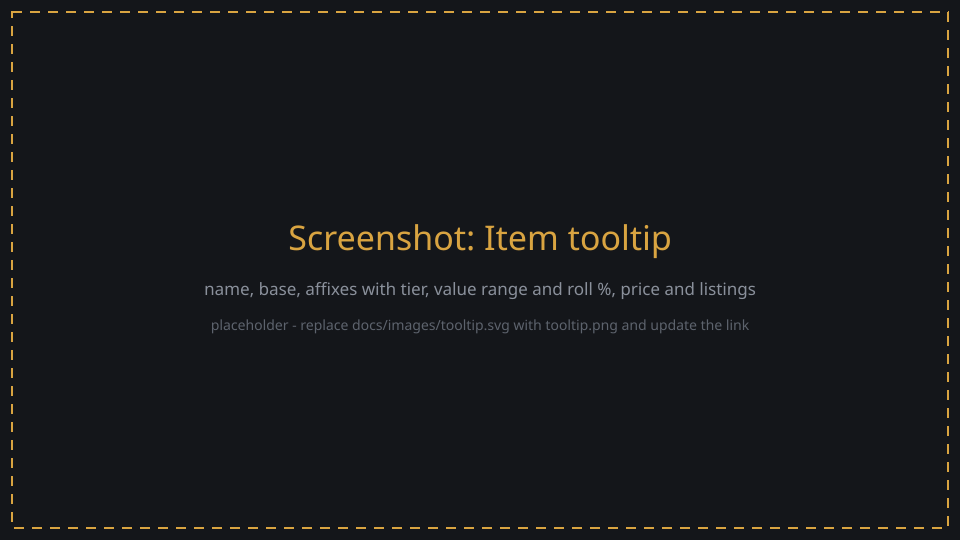
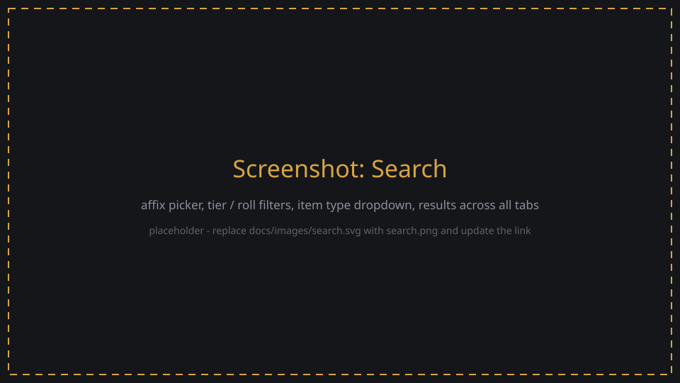
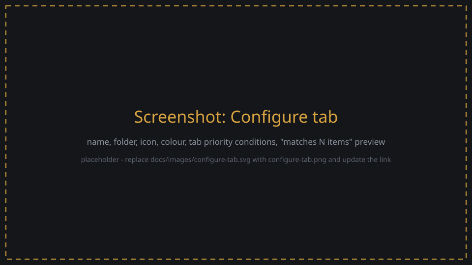
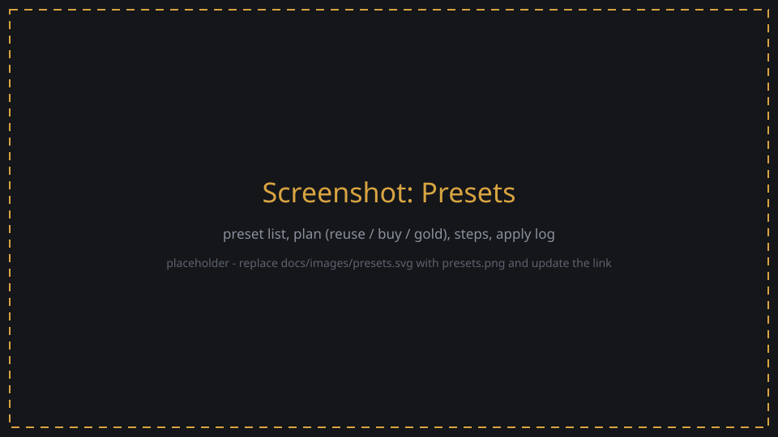
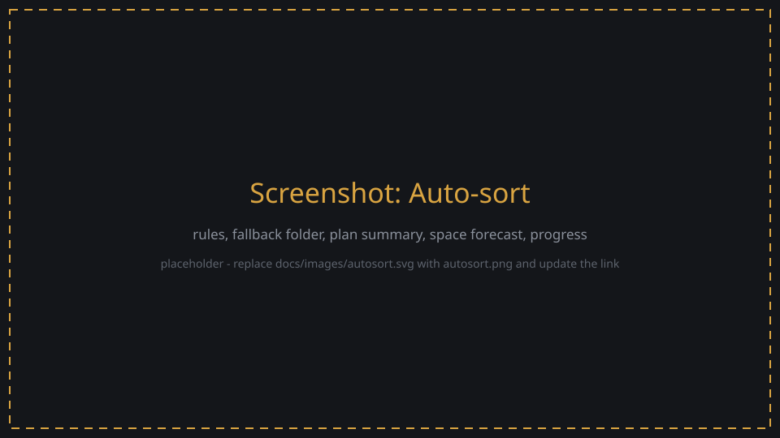

# Using LE StashManager

A tour of the page. Install first: see the [README](../README.md#install).

**Start:** launch Last Epoch, load your character, run `run.bat`, open <http://127.0.0.1:8100>.

**From a phone, tablet or second PC:** run `run.bat lan`. The window prints a link with an access
key (`http://<this PC>:8100/?key=...`); open it once on the other device and it is remembered there.
Without the key other devices get nothing, because the page can move items and spend gold. Keep the
link private; `host.py --lan --new-key` makes a new key and old links stop working.
Reading and searching work anywhere in the game. Anything that **changes** your stash (moving items,
configuring or buying tabs) needs the **stash open in game**. The header shows **at stash** when it is.

## The page at a glance

| Area | What it shows |
|---|---|
| Header | connection, **at stash** / stash closed, total stash value, Presets, Auto-sort, refresh |
| Left: tabs | folders and tabs in game order, item count and value per tab; ⚑ = tab has a priority rule; green dot = tab open in game |
| Middle: grid | the selected tab as in game: item art, affix tiers, price tag on items worth 50k+ |
| Right: search | filters across all tabs; matches light up in the grid, the list below jumps to them |

Hover an item for its tooltip:

- name, rarity, base type, size
- every affix: prefix / suffix, tier, rolled value with the tier's range, roll %
- LP, WW, FP, level requirement, corrupted
- price estimate, number of listings, and how it was priced (see [Prices](#prices))

## Search

- **Text**: words in the item name, base, or affixes. Wrap in slashes for a regex: `/crit.*multi/`.
- **Affix conditions** (`+ affix condition`): start typing and pick an affix from the list. A picked
  affix matches exactly ("Health" is not "Health Regeneration"); typed text matches partially.
  Add a minimum tier and a minimum roll %. Combine conditions with *match all* or *match any*.
- **At least N affixes with tier ≥ X**: e.g. 2 × T7 for double-T7 exalts.
- **Item type**: dropdown with groups (Armour, Jewellery, 1H, 2H, Off-hand, Idols, Other). Click a
  group heading to toggle the whole group; the counts show how many you own.
- **Rarity**, **LP / WW / FP ≥**, **corrupted**, **level requirement ≤**, **open prefix / suffix**,
  **price ≥**.
- **Save** a search to reuse it later, or to turn it into an auto-sort rule.

## Tabs and folders

Hover a tab or folder in the left panel: **↑ / ↓** reorder, **⚙** configure. The top of the panel
has **+ Tab** (buy) and **+ Folder**.

The Configure Tab window mirrors the game's:

- name, folder, icon and colour (the game's own)
- **Tab priority**: the game's auto-stash rules (uniques, type, rarity, LP / FP / WW / WT, class,
  level, corruption, faction). The preview shows how many of your items the rule matches.
- **Buy tab** shows the gold cost and asks twice. Tabs cannot be deleted in Last Epoch.

Folders have a name, icon and colour (the game has no folder rules). A folder can be deleted once
it is empty.

## Presets

A preset is a whole stash layout: folders, tabs, icons, colours, rules and order.

- **Built-in**: *Starter* (8 tabs) and *Artem-style full layout* (exalts per slot, uniques by LP,
  legendary, sets, idols by size, idol altars, crafting bases, dumps).
- **Save current layout**, **Import** (paste or pick a JSON file), **Export**.
- Pick a preset to see the plan: how many of your tabs it **reuses** (same name first, then tabs
  that already hold the right items, then the emptiest), how many it **buys**, and the **gold**.
- **Apply** (asks twice) saves your current layout as *Backup &lt;date&gt;* first, then runs each
  step and checks it in game. Apply the backup to undo names, colours, rules and order (bought tabs stay).

Presets do not move items. Run **Auto-sort** afterwards.

## Auto-sort

Where an item goes, first match wins:

1. **Your rules**: any search can become a rule "→ tab X" (`+ Rule from current search`). Use it for
   things the game's rules can't express, like affixes ("T7 Health body armour → Tank gear").
   Rules are ordered and can be switched off.
2. **Game tab priorities**, checked left to right like the game does.
3. **Fallback**: a tab or a whole folder (default: *Other*), also used when target tabs are full.

Items already sitting in a matching tab stay where they are.

Before anything moves you see:

- how many items move to each tab, how many stay, how many match nothing
- the full list of moves
- the **space forecast**: per tab (tabs sharing a rule are counted together) how many items belong
  there, how full it gets, and what won't fit, with a **+ buy "Name 2"** button for an overflow tab
  with the same rule (placed right after it, asks twice).

**Move items** (asks twice) starts a background job. It works through your inventory in batches,
lets the game place items by tab priority, and checks every item afterwards. **Stop** is safe at
any time; closing the stash stops it too. Keep some inventory space free: the batch size is your
free inventory space.

Tip: start with **Sort items from → one tab** to watch a small run first.

## Prices

From the public [Last Epoch Overlay](https://www.leoverlay.com/developers) feed: community-observed
**asking prices**, not sales.

| Item | Priced by |
|---|---|
| unique / set | unique + LP |
| idol | exact affix combination, else same affixes at other tiers (marked *low volume*) |
| magic / rare / exalted | the item's most valuable affix (an estimate) |
| legendary | estimate: the higher of the unique's base price and its best affix |

Shards, runes, glyphs and keys have no price data. Prices refresh hourly.

## Item art

On first start the page shows a banner: **Extract item pictures**. The game must be running (it tells
us which picture each item uses); the pictures are read from your local game files into `data/icons`,
nothing is downloaded. Takes about a minute. Tab icons follow automatically the first time you open
the stash. After a game patch, run `.venv\Scripts\python tools\extract_icons.py` for new items.

More help: [TROUBLESHOOTING.md](TROUBLESHOOTING.md).
